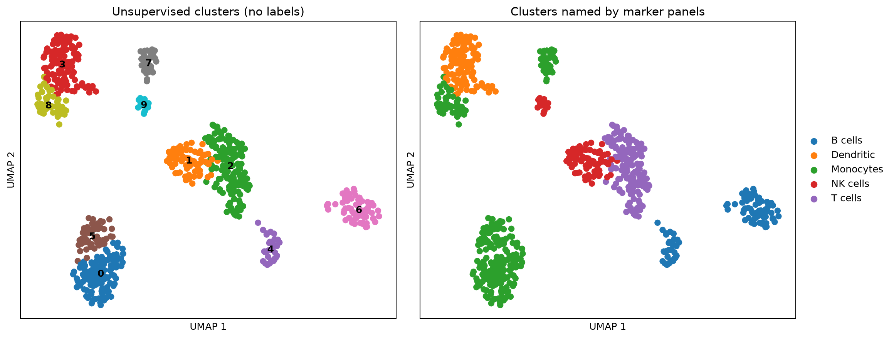
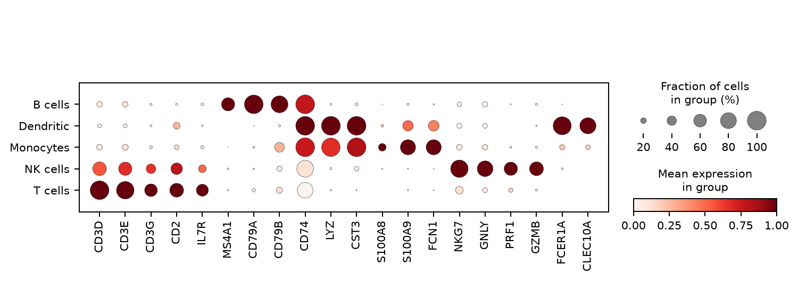
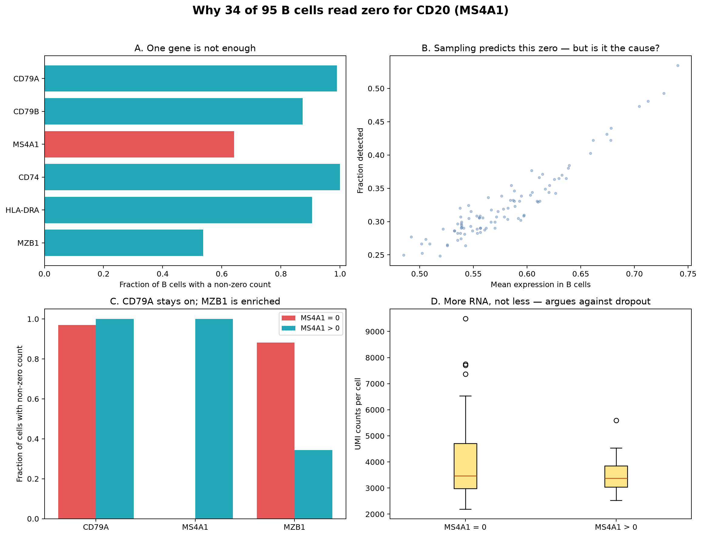

# One marker, two failure modes

### Auditing CD20 (MS4A1) in 700 single immune cells

> **The finding in one sentence:** 34 of 95 B cells read **zero** for the canonical
> B-cell marker CD20 — and the evidence says most of them are not a measurement
> failure. They are CD20-low antibody-producing cells (plasmablasts), which
> genuinely switch the marker off.

This is a small, careful **single-cell data analysis project**. It is **not** a
Nextflow/Snakemake pipeline and **not** a published paper. It is a portable
analysis you can reproduce in a couple of minutes, built around one question:

> What happens when you use a single, protein-defined marker to identify cells
> in sparse single-cell RNA-seq data?

---

## 1. Background — where the question came from

CD20 (gene **MS4A1**) is one of the standard markers used to identify B cells
[1, 5]. Single-cell RNA-seq, however, captures only a fraction of each cell's
RNA, so a gene can be present but not detected — a **technical zero**, or
"dropout" [2].

Putting those two facts together gives the question. A simple binomial thought
experiment makes it feel obvious: if a B cell carries ~10 MS4A1 molecules and
the assay catches ~10% of them, the chance of seeing zero is

```
(1 − 0.10)^10 ≈ 0.35  →  35%
```

The observed rate in this dataset is **34/95 = 35.8%**. The dropout hypothesis
looks convincing — until you check whether it is actually true.

## 2. What was done

**Part 1 — the atlas (setup).**
The 700-cell reduced PBMC dataset shipped with Scanpy [3, 4] was clustered with
PCA → neighbours → Leiden → UMAP. The coarse cell-type labels in the dataset
were **withheld** during clustering and used only for validation afterwards.
Clusters were named from marker panels (CD3D/E for T cells, MS4A1/CD79A for B
cells, LYZ/CST3 for monocytes, NKG7/GNLY for NK). Of the 95 cells labelled
`CD19+ B`, 92 landed in marker-defined B clusters.

**Part 2 — the audit (the actual project).**
Within those 95 B cells, MS4A1 was checked one cell at a time. The zero cells
were then compared with the positive cells for:

- retention of another B-lineage marker (**CD79A**),
- expression of a plasma-cell marker (**MZB1**; the only plasma marker present
  in this reduced 765-gene matrix),
- total UMI counts (a proxy for how much RNA was captured).

## 3. Results

| Check | MS4A1 = 0 (n=34) | MS4A1 > 0 (n=61) | Reading |
|---|---|---|---|
| CD79A detected | **33 / 34** | 61 / 61 | Still B lineage |
| MZB1 detected | **30 / 34** | 21 / 61 | Plasma signature enriched |
| MZB1-high | **28 / 34** | 4 / 61 | Strongly enriched |
| Mean UMI counts | **4,210** | 3,482 | More RNA, not less |

**Interpretation.** The naive explanation (dropout) predicts *lower* RNA content
in the zero cells. The opposite is observed. The zero cells keep CD79A, are
enriched for the plasma marker MZB1, and have more RNA. CD20 is known to be lost
when B cells terminally differentiate into plasmablasts and plasma cells [1].
So most of the 34 zeros are best explained as **real biology, not failed
measurement**.

The lesson is not "the textbook is wrong". The textbook is right. The mistake
is treating a marker of a B-cell **state** as a definition of B-cell **identity**.
A single gene produces the same zero for two different reasons; a small panel
plus basic QC distinguishes them.

## 4. Figures

**Figure 1 — Unsupervised clusters and their marker-based names.**



**Figure 2 — Marker evidence used to name the clusters.**



**Figure 3 — The four-panel CD20 audit: detection rates, the sampling model,
marker retention, and RNA content.**



## 5. Reproduce

```bash
python3 -m venv .venv
.venv/bin/pip install -r requirements.txt
.venv/bin/python scripts/01_build_atlas.py
.venv/bin/python scripts/02_cd20_audit.py
```

The dataset downloads automatically through Scanpy on first use. All random
seeds are fixed. Tables are written to `results/`.

## 6. Repo structure

```
src/immune_atlas.py       reusable functions (load, cluster, annotate, audit)
scripts/01_build_atlas.py unsupervised atlas — labels withheld
scripts/02_cd20_audit.py  the marker audit and figure
figures/                  generated figures
results/                  generated tables
requirements.txt          pinned versions
```

The audit functions in `src/` are written to take any AnnData object, so the
same check can be pointed at another dataset.

## 7. Limitations

- The reduced matrix contains **765 genes**. MZB1 is the only plasma-cell marker
  available; PRDM1, XBP1, JCHAIN and the immunoglobulins are absent. The plasma
  call is strongly suggestive but needs the full dataset to confirm.
- `CD19+ B` is a coarse sort label that lumps plasma cells into the B bucket —
  which is precisely why a single-marker definition fails here.
- One donor, one dataset. No protein-level measurement (CITE-seq) to confirm
  CD20 surface expression directly.

## 8. What I would do next

1. Repeat the audit on the full PBMC dataset with the complete plasma-cell gene
   panel, to separate dropout from true CD20 loss quantitatively.
2. Subset the MS4A1-zero cells and check for the plasma transcriptional program
   (PRDM1, XBP1, JCHAIN, IGHG1).
3. Validate at protein level with CITE-seq or flow cytometry if available.
4. Package the audit as a reusable QC check for any marker gene.

## 9. References

1. Pavlasova G, Mráz M. The regulation and function of CD20: an "enigma" of
   B-cell biology and targeted therapy. *Haematologica*. 2020;105(6):1494–1506.
   doi:10.3324/haematol.2019.243543
2. Kharchenko PV, Silberstein L, Scadden DT. Bayesian approach to single-cell
   differential expression analysis. *Nature Methods*. 2014;11:740–742.
   doi:10.1038/nmeth.2967
3. Wolf FA, Angerer P, Theis FJ. SCANPY: large-scale single-cell gene expression
   data analysis. *Genome Biology*. 2018;19(1):15.
   doi:10.1186/s13059-017-1382-0
4. Zheng GXY et al. Massively parallel digital transcriptional profiling of
   single cells. *Nature Communications*. 2017;8:14049.
   doi:10.1038/ncomms14049
5. Janeway CA Jr et al. *Janeway's Immunobiology*. 9th ed. Garland Science; 2017.

> The 34/95 observation and its interpretation are the result of this project;
> the references support the background and the biological interpretation.
